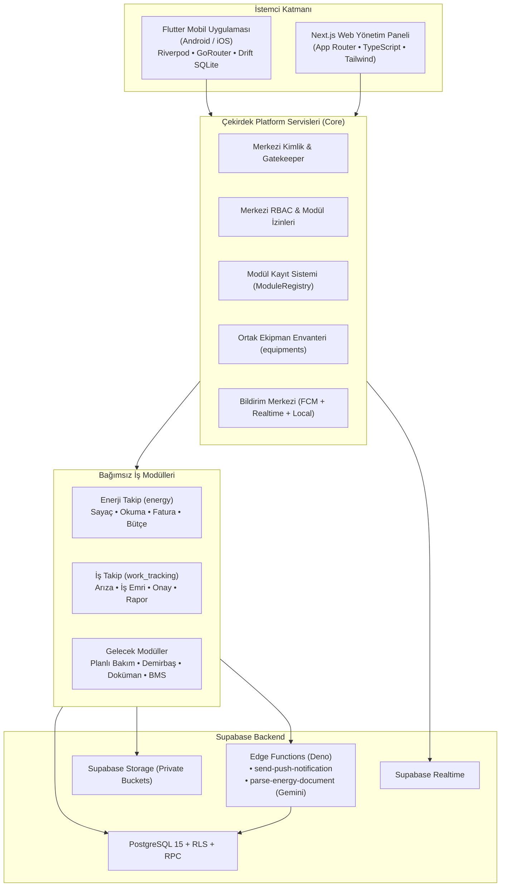

# AVM TECH – SİSTEM MİMARİSİ (`ARCHITECTURE.md`)

> **Sürüm:** `v0.1.0-docs`  
> **Mimari Yaklaşım:** Modüler Monorepo + Çekirdek/Eklenti (Core & Feature Modules) + Tek Supabase Backend

---

## 1. Üst Düzey Sistem Mimarisi

AVM TECH, tek bir **Supabase (PostgreSQL)** veritabanı ve kimlik altyapısı üzerinde çalışan iki istemci (Flutter Mobil + Next.js Web Yönetim Paneli) ve sunucu tarafı Edge Functions katmanından oluşur.



---

## 2. Temel Mimari Kararlar

| Alan | Karar | Gerekçe |
|---|---|---|
| **Repo Yapısı** | Tekil Monorepo | Dart modelleri, TypeScript tipleri ve SQL migration'larının tek merkezde tutarlı kalması. |
| **Backend** | Tek Supabase Projesi | Tek kullanıcı hesabı, tek oturum, güçlü ilişkisel veri bütünlüğü (PostgreSQL) ve veritabanı seviyesinde güvenlik (RLS). |
| **Modül İzolasyonu** | Feature-First (Özellik Odaklı) | Enerji Takip'te yapılan bir değişiklik İş Takip'i etkilemez; her modül kendi `data/`, `domain/`, `presentation/` klasörüne sahiptir. |
| **Modül Kaydı** | Sade `ModuleRegistry` + `system_modules` tablosu | Yeni modül eklerken mevcut modüllerde değişiklik gerekmez; gereksiz karmaşık dinamik eklenti/reflection altyapısı yerine açık compile-time kayıt listesi + veritabanı aktiflik kontrolü kullanılır. |
| **Ortak Ekipman** | Çekirdek `equipments` tablosu | Tüm modüllerin kullandığı merkezi ekipman kayıt sistemi; enerji tüketimi, arızalar, planlı bakım ve teknik dokümanlar aynı `equipment_id` üzerinden bağlanır. |
| **Mobil Durum Yönetimi** | Riverpod | Compile-time güvenli, kolay test edilebilir, modüller arası bağımlılığı kontrollü yöneten yapı. |
| **Mobil Yönlendirme** | GoRouter | Merkezi oturum/onay/modül yetki muhafızları (`redirect` guards) ve modül bazlı alt rota (`ShellRoute` / dinamik route kayıtları). |
| **Offline Çalışma** | Drift (SQLite) | Otopark, kazan dairesi ve pano odaları gibi internetin zayıf olduğu alanlarda hem arıza taslakları hem de sayaç okumaları yerel kuyrukta tutulup bağlantı gelince senkronize edilir. |
| **Yapay Zeka & PDF** | Supabase Edge Function (`parse-energy-document`) | Mevcut `sayac_takip_app` içindeki istemci tarafı Gemini API çağrısı sunucuya taşınır; API anahtarı asla istemcide tutulmaz. |
| **Tasarım Dili** | Kurumsal AVM TECH Kimliği (Material 3) | Ana Lacivert (`#17365D`), İkincil Lacivert (`#254B75`), Beyaz (`#FFFFFF`), Zemin (`#F4F6F9`). Sade, hızlı, yatay taşmasız, düşük animasyonlu kurumsal arayüz. |

---

## 3. Modül Bağımsızlık Kuralları

Modüller arasındaki sınırlar kesin kurallarla korunur:

1. **Çekirdeğe Tek Yönlü Bağımlılık:** Her modül `core/` katmanındaki ortak servisleri (Auth, Permissions, Theme, Storage, Notifications, Equipment Referansı, API Client) kullanabilir.
2. **Modüller Arası Doğrudan Import Yasağı:** `features/energy/` içindeki bir dosya `features/work_tracking/` içindeki bir ekranı, provider'ı veya servisi doğrudan import edemez.
3. **Veritabanı Sınırları:** Her modül yalnızca kendi tablolarına yazar. Modüller arası ilişki yalnızca çekirdek tablolar (`profiles`, `departments`, `locations`, `equipments`) üzerinden kurulur.
4. **Hata İzolasyonu:** Bir modülün veri çekme veya ekran hatası ana modül seçim ekranını veya diğer modülleri çökertmez.
5. **Tembel Yükleme (Lazy Loading):** Modül provider'ları ve verileri yalnızca kullanıcı ilgili modüle girdiğinde yüklenir; açılışta tüm modüllerin verisi çekilmez.

---

## 4. Kullanıcı Akışı ve Navigasyon Mimarisi

### Mobil Uygulama Akışı
```
Splash -> Auth & Gatekeeper Kontrolü
  ├── Oturum Yok -> Login (E-posta / Ad Soyad / Telefon) veya Kayıt Ol
  ├── Onay Bekliyor (pending) -> Pending Approval Ekranı
  └── Onaylı (approved) -> Modül Seçim Ekranı (/home)
        ├── [Enerji Takip Kartı] -> /energy (İç Navigasyon: Özet, Elektrik, Mekanik, Faturalar, Bütçe)
        ├── [İş Takip Kartı]     -> /work-tracking (İç Navigasyon: Özet, Arızalar, İş Emirleri, Yeni Arıza)
        ├── [Gelecek Modüller]   -> Aktifse görünür, yetki yoksa gizli/pasif
        └── [Ortak Üst Bar]      -> Bildirimler (/notifications) & Profil (/profile)
```

### Web Yönetim Paneli Akışı (Next.js)
- **Sol Sidebar** üç bölümden oluşur:
  1. **Platform:** Ana Panel (Modül Özeti), Bildirimler
  2. **Aktif Modüller (Yetkiye göre dinamik):**
     - *İş Takip:* Genel Bakış, Arıza Kayıtları, İş Emirleri, Onay Bekleyenler, Raporlar
     - *Enerji Takip:* Enerji Özeti, Sayaç Yönetimi, Okuma Geçmişi, Faturalar & PDF Analiz, Bütçe & Karşılaştırma, Enerji Raporları
  3. **Yönetim & Çekirdek Tanımlar:** Personel & Yetkiler, Modül Yönetimi, Departmanlar, Kat & Mahaller, Ekipman Envanteri, Sistem Ayarları

---

## 5. Offline (Çevrimdışı) Mimari (Drift / SQLite)

Sahadaki teknik personel bodrum katlarda, trafo merkezlerinde ve mekanik odalarda sıkça internet kesintisi yaşar. Drift/SQLite altyapısı 5 net bileşenle standartlaştırılır:

### 5.1 Yerel Kayıt Kuyruğu (`local_sync_queue`)
- İnternet yokken oluşturulan sayaç okumaları, arıza bildirimleri, iş emri güncellemeleri ve yorumlar `client_mutation_id` (UUID) ile kuyruğa eklenir.
- Her kuyruk kaydında `module_key`, `entity_type`, `operation` (`insert`/`update`), `payload_json`, `status`, `retry_count`, `last_error`, `next_retry_at`, `created_at` tutulur.

### 5.2 Senkronizasyon Durum Makinesi (`sync_status`)
- `pending` → Kuyrukta bekliyor (bağlantı bekleniyor)
- `syncing` → Sunucuya gönderiliyor (çift gönderimi engellemek için kilitli)
- `synced` → Sunucuda doğrulandı (yerel önbellek güncellendi)
- `failed` → Geçici ağ/sunucu hatası aldı (tekrar denenecek)
- `conflict` → Sunucuda daha güncel veya çakışan kayıt bulundu (kullanıcı kararı gerekir)

### 5.3 Tekrar Deneme (Retry) Politikası
- Geçici hatalarda (zaman aşımı, 5xx, ağ kopması) **üstel geri çekilme (exponential backoff)** uygulanır: `10sn → 30sn → 2dk → 10dk → 30dk` (maksimum 5 otomatik deneme).
- 5 deneme sonunda `failed` durumunda kalır; kullanıcı "Tekrar Dene" butonuyla manuel tetikleyebilir.
- Yetki (403) veya doğrulama (400) hatalarında sonsuz döngüye girilmez, kayıt doğrudan `failed` işaretlenip açıklayıcı hata mesajı gösterilir.

### 5.4 Veri Çakışması Çözümü (Conflict Resolution)
- **Ekleme (Insert) Çakışması:** `client_mutation_id` (idempotency key) sayesinde aynı kayıt iki kez yazılsa bile sunucu mükerrer kayıt oluşturmaz.
- **Güncelleme (Update) Çakışması:** Kuyruktaki kaydın `base_updated_at` değeri sunucudaki `updated_at` ile karşılaştırılır.
  - Arıza/İş Emri durum güncellemelerinde sunucu durumu ilerlemişse kayıt `conflict` durumuna alınır ve kullanıcıya **"Sunucu sürümünü koru"** veya **"Değişikliğimi yeniden uygula"** seçenekleri sunulur.
  - Aynı gün/aynı sayaç için çift okuma tespit edilirse kullanıcıya çakışma uyarısı gösterilir.

### 5.5 Fotoğraf ve Dosya Senkronizasyonu (`local_media_queue`)
- Fotoğraf çekildiğinde cihaz içi geçici dizine kaydedilir ve önce maksimum `1600px` genişlik / `%80` JPEG kalitesine sıkıştırılır.
- Senkronizasyon sırası **2 aşamalıdır**:
  1. Önce bağlı `local_media_queue` dosyaları Supabase Storage'a yüklenir ve `storage_path` alınır.
  2. Tüm bağlı fotoğraflar başarıyla yüklendikten sonra ana kayıt (`ticket`, `work_order` vb.) `storage_path` referanslarıyla sunucuya gönderilir.
- Fotoğraf yüklemesi yarım kalırsa ana kayıt `pending` kalır; bağlantı gelince yalnızca eksik dosya tekrar yüklenir.

---

## 6. Ortak Altyapının Yeniden Kullanımı (Gelecek Modül Hazırlığı)

Gelecekte **Planlı Bakım** veya **Demirbaş** modülü eklendiğinde aşağıdaki 4 merkezi altyapı kesinlikle tekrar yazılmaz; `core/` katmanından doğrudan tüketilir:
1. **Ortak Ekipman Yönetimi (`core/equipment` + `equipments` tablosu):** Ekipman seçici, ekipman kartı ve `equipment_id` ilişkisi.
2. **Merkezi Kullanıcı & Yetkilendirme (`core/auth`, `core/permissions`):** Tek giriş, 8 granüler modül izni ve RLS yardımcıları.
3. **Merkezi Bildirim Altyapısı (`core/notifications` + `notifications` tablosu):** FCM, Realtime ve yerel bildirimler (`module_key` ile ayrışır).
4. **Ortak Raporlama & Dışa Aktarma Yardımcıları (`core/reporting`):** Excel/CSV/PDF oluşturma ve paylaşım/indirme akışı.

---

## 7. Güvenlik Mimarisi

1. **Veritabanı Seviyesi Yetkilendirme (RLS):** İstemci arayüzünde buton gizlemek tek başına güvenlik sayılmaz; tüm `SELECT / INSERT / UPDATE / DELETE` işlemleri PostgreSQL RLS politikaları ve `SECURITY DEFINER` RPC fonksiyonları ile doğrulanır.
2. **Gatekeeper Modeli:** Yeni kayıt olan kullanıcılar `approval_status = 'pending'` durumunda başlar; yönetici onaylayana kadar hiçbir modül verisine erişemez.
3. **Gizli Anahtarların Sunucuya Alınması:**
   - `GEMINI_API_KEY` yalnızca Supabase Edge Function ortam değişkeni (Secret) olarak saklanır.
   - `FCM_SERVICE_ACCOUNT` yalnızca `send-push-notification` Edge Function ortamında bulunur.
4. **Özel Dosya Depolama:** Arıza/çözüm fotoğrafları (`work-attachments`) ve enerji fatura/bütçe PDF'leri (`energy-documents`) `private` bucket'larda tutulur; erişim kısa ömürlü imzalı URL (Signed URL) ve RLS ile sağlanır.
5. **Eski Sistem ve Veri Güvenliği:** Firebase verileri aktarılmadan önce yedeklenir, kullanıcı eşleştirmeleri doğrulanır ve geçiş doğrulanana kadar mevcut iki canlı sistem çalışmaya devam eder.
6. **Çoklu AVM (Multi-Tenant) Hazırlığı:** Sistem tek AVM için sade başlar, ancak çekirdek tablolara ileride `site_id` eklenebilecek şekilde servis arayüzleri soyutlanır.

---

## 8. Performans İlkeleri

- **İhtiyaç Anında Yükleme (Lazy Loading):** Modüllerin provider'ları, repository'leri ve verileri yalnızca kullanıcı ilgili modüle girdiğinde başlatılır.
- **Sayfalama ve Filtreleme:** Tüm büyük veri tablolarında (`tickets`, `work_orders`, `meter_readings`, `energy_invoices`, `notifications`, `equipments`) sunucu taraflı sayfalama ve filtreleme zorunludur.
- **İndeksleme:** Sık filtrelenen ve sıralanan tüm sütunlarda bileşik indeksler (composite indexes) tanımlanır (detaylar `DATABASE.md`).
- **Optimize Dashboard Sorguları:** N+1 sorgu problemi engellenir; özet ekranları için PostgreSQL `VIEW` veya tek çağrılı özet `RPC` fonksiyonları kullanılır (`rpc_energy_dashboard_summary`, `rpc_work_tracking_summary`).
