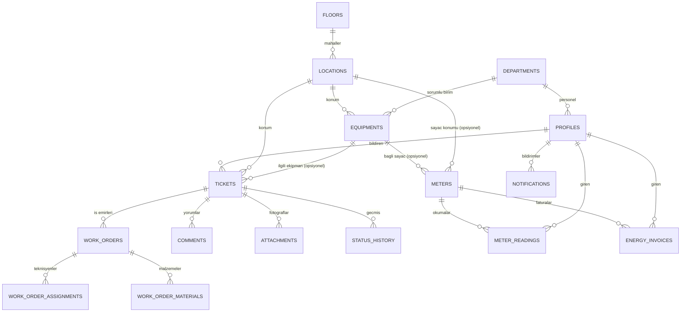

# AVM TECH – VERİTABANI TASARIMI (`DATABASE.md`)

> **Sürüm:** `v0.1.0-docs`  
> **Motor:** Supabase / PostgreSQL 15  
> **Güvenlik:** Tüm tablolarda Row Level Security (RLS) zorunludur.

---

## 1. Şema Organizasyonu

Veritabanı 3 mantıksal katmana ayrılır. Tablolar `public` şemasında, okunabilir ve çakışmasız isimlendirme ile tutulur:

1. **Çekirdek Katman (Core):** Kimlik, yetki, modül kaydı, fiziksel konumlar, ortak ekipman envanteri ve bildirimler.
2. **İş Takip Modülü (`work_tracking`):** Mevcut `TEKNİK İŞ İSTEK` tablolarının korunmuş ve `equipment_id` ile zenginleştirilmiş hali.
3. **Enerji Takip Modülü (`energy`):** Mevcut `sayac_takip_app` Firestore koleksiyonlarının ilişkisel PostgreSQL karşılıkları.

---

## 2. Varlık İlişki Özeti (ER Diyagramı)

---

## 3. Çekirdek Tablolar (Core)

### 3.1 `system_modules` (Merkezi Modül Kayıt Tablosu)
Ana ekrandaki modüllerin aktiflik durumu, sırası ve meta bilgileri burada tutulur.
- `key` (`text`, PK) – Örn: `'energy'`, `'work_tracking'`, `'maintenance'`, `'assets'`
- `name` (`text`, not null) – Örn: `'Enerji Takip'`, `'İş Takip'`
- `description` (`text`)
- `icon` (`text`, not null) – İkon anahtarı (mobil & web ortak harita)
- `route_prefix` (`text`, not null, unique) – Örn: `'/energy'`, `'/work-tracking'`
- `is_enabled` (`boolean`, not null, default `true`) – Sistem genelinde modülü aç/kapat
- `is_coming_soon` (`boolean`, not null, default `false`) – Gelecek modül etiketi
- `sort_order` (`integer`, not null, default `0`)
- `created_at`, `updated_at` (`timestamptz`)

### 3.2 `departments`, `floors`, `locations`, `custom_roles`
Mevcut `TEKNİK İŞ İSTEK` şeması birebir korunur:
- `departments (id, name, description, is_active, created_at)`
- `floors (id, name, sort_order, is_active, created_at)`
- `locations (id, floor_id, name, description, is_active, created_at)` – `UNIQUE (floor_id, name)`
- `custom_roles (id, name, base_role, created_at)`

### 3.3 `profiles` (Tekil Kullanıcı Profili)
Mevcut `TEKNİK İŞ İSTEK` profil tablosu genişletilir:
- `id` (`uuid`, PK, references `auth.users(id)` on delete cascade)
- `full_name` (`text`, not null)
- `phone` (`text`)
- `role` (`public.user_role`, not null, default `'employee'`) – `employee`, `technician`, `team_lead`, `technical_manager`, `system_admin`
- `custom_role` (`text`)
- `approval_status` (`public.approval_status`, not null, default `'pending'`) – `pending`, `approved`, `rejected`, `disabled`
- `department_id` (`uuid`, references `departments(id)`)
- `permissions` (`jsonb`, not null, default `'{}'::jsonb`) – Merkezi modül & işlem yetkileri (`PERMISSIONS.md`)
- `legacy_firebase_uid` (`text`, unique) – *Firebase'den aktarılan kullanıcı eşleştirmesi için*
- `approved_by` (`uuid`, references `profiles(id)`)
- `approved_at`, `created_at`, `updated_at` (`timestamptz`)

### 3.4 `equipments` (Ortak Teknik Ekipman Altyapısı)
Tüm modüllerin kullanabileceği merkezi ekipman kayıt sistemidir. Enerji tüketimi (`meters.equipment_id`), arızalar (`tickets.equipment_id`, `work_orders.equipment_id`), gelecekteki **Planlı Bakım** (`maintenance_*.equipment_id`) ve **Teknik Dokümanlar** (`equipment_documents.equipment_id`) aynı `equipment_id` üzerinden ilişkilendirilir:
- `id` (`uuid`, PK, default `gen_random_uuid()`)
- `code` (`text`, unique, not null) – Örn: `CHL-01`, `TRAFO-01`, `KZN-02`
- `name` (`text`, not null) – Örn: `'1 No.lu Soğutma Grubu (Chiller)'`
- `equipment_type` (`text`, not null) – Örn: `'hvac'`, `'electrical_panel'`, `'boiler'`, `'pump'`, `'elevator'`, `'escalator'`, `'generator'`, `'other'`
- `department_id` (`uuid`, references `departments(id)` on delete set null)
- `location_id` (`uuid`, references `locations(id)` on delete set null)
- `brand` (`text`), `model` (`text`), `serial_number` (`text`)
- `warranty_end_date` (`date`)
- `status` (`text`, not null, default `'active'`) – `'active'`, `'maintenance'`, `'out_of_service'`, `'retired'`
- `metadata` (`jsonb`, default `'{}'::jsonb`) – Teknik kapasite/etiket bilgileri
- `is_active` (`boolean`, not null, default `true`)
- `created_by` (`uuid`, references `profiles(id)` on delete set null)
- `created_at`, `updated_at` (`timestamptz`)
- **İndeksler:** `idx_equipments_type_status (equipment_type, status)`, `idx_equipments_location (location_id)`, `idx_equipments_department (department_id)`

### 3.5 `notifications` (Merkezi Bildirim Tablosu)
Mevcut bildirim tablosu modül-bağımsız hale getirilir:
- `id` (`uuid`, PK)
- `user_id` (`uuid`, not null, references `profiles(id)` on delete cascade)
- `module_key` (`text`, not null, default `'work_tracking'`) – `'work_tracking'`, `'energy'`, `'system'`
- `entity_type` (`text`) – Örn: `'ticket'`, `'work_order'`, `'meter_reading'`, `'invoice'`
- `entity_id` (`uuid`) – İlgili kaydın UUID'si
- `ticket_id` (`uuid`, references `tickets(id)` on delete cascade) – *Geriye dönük uyumluluk için*
- `title` (`text`, not null)
- `message` (`text`, not null)
- `is_read` (`boolean`, not null, default `false`)
- `created_at` (`timestamptz`, not null, default `now()`)

---

## 4. İş Takip Modülü Tabloları (`work_tracking`)

Mevcut `TEKNİK İŞ İSTEK` tabloları (17 migration dahil) eksiksiz korunur:
- `categories (id, name, department_id, icon, is_active, created_at)`
- `tickets` – Tüm mevcut sütunlar (`ticket_number`, `reporter_id`, `location_id`, `custom_location`, `category_id`, `custom_category`, `priority`, `status`, `description`, `cancellation_reason`, `resolved_at`, `closed_at`) + **`equipment_id` (`uuid`, nullable, references `equipments(id)` on delete set null)**
- `work_orders` – Tüm mevcut sütunlar + **`equipment_id` (`uuid`, nullable, references `equipments(id)` on delete set null)**
- `work_order_assignments (id, work_order_id, user_id, assigned_by, assigned_at)`
- `work_order_materials (id, work_order_id, material_name, quantity, unit, note, recorded_by, created_at)`
- `comments (id, ticket_id, work_order_id, user_id, comment, created_at)`
- `attachments (id, ticket_id, work_order_id, uploaded_by, file_path, file_name, mime_type, attachment_type, created_at)`
- `status_history (id, ticket_id, old_status, new_status, changed_by, change_note, created_at)`

**Korunan İş Kuralları & Tetikleyiciler:**
- `ticket_number_trigger` (`AVM-YYYY-XXXXXX`)
- `ticket_status_history_trigger`
- Bildiricinin onayında (`resolved`) bekleyen 3 iş isteği varsa yeni arıza açılmasını engelleyen kural
- `rpc_manager_close_ticket` (yönetici veya bildirici onay/iade akışı)
- `rpc_resolve_login_email` (e-posta, ad soyad veya telefon ile giriş)

---

## 5. Enerji Takip Modülü Tabloları (`energy`)

Mevcut `sayac_takip_app` Firestore yapısının normalize edilmiş PostgreSQL şeması:

### 5.1 `meters` (Sayaç Tanımları)
- `id` (`uuid`, PK, default `gen_random_uuid()`)
- `legacy_id` (`text`, unique) – *Firestore doküman ID'si (örn. `gt_adp_1`), aktarım ve geriye dönük eşleştirme için*
- `name` (`text`, not null)
- `meter_type` (`text`, not null, check in `('electric', 'mechanical')`)
- `category` (`text`, not null, check in `('electric', 'water', 'cooling', 'gas', 'other')`)
- `multiplier` (`numeric(12,4)`, not null, default `1.0`, check > 0)
- `sort_order` (`integer`, not null, default `0`) – Mevcut `orderIndex` karşılığı
- `meter_no` (`text`), `contract_no` (`text`), `eic_code` (`text`), `tekil_code` (`text`), `subscriber_no` (`text`), `region` (`text`)
- `equipment_id` (`uuid`, nullable, references `equipments(id)` on delete set null) – *Ortak ekipman bağlantısı*
- `location_id` (`uuid`, nullable, references `locations(id)` on delete set null)
- `is_active` (`boolean`, not null, default `true`)
- `created_at`, `updated_at` (`timestamptz`)

### 5.2 `meter_readings` (Sayaç Okumaları)
- `id` (`uuid`, PK, default `gen_random_uuid()`)
- `legacy_id` (`text`, unique) – *Firestore reading ID*
- `meter_id` (`uuid`, not null, references `meters(id)` on delete cascade)
- `reading_date` (`timestamptz`, not null)
- `active_value` (`numeric(14,3)`) – Elektrik aktif endeks
- `inductive_value` (`numeric(14,3)`) – Elektrik indüktif endeks
- `capacitive_value` (`numeric(14,3)`) – Elektrik kapasitif endeks
- `inductive_percent` (`numeric(6,2)`) – Reaktif indüktif % (>20 uyarı)
- `capacitive_percent` (`numeric(6,2)`) – Reaktif kapasitif % (>15 uyarı)
- `index_value` (`numeric(14,3)`) – Mekanik endeks
- `consumption` (`numeric(14,3)`, not null, default `0`)
- `entered_by_id` (`uuid`, references `profiles(id)` on delete set null)
- `entered_by_name` (`text`, not null) – *Kullanıcı adı anlık görüntüsü (eski veriler dahil)*
- `notes` (`text`)
- `created_at`, `updated_at` (`timestamptz`)
- **İndeks:** `INDEX idx_meter_readings_meter_date ON meter_readings (meter_id, reading_date DESC)`

### 5.3 `energy_invoices` (Aylık Enerji Faturaları)
- `id` (`uuid`, PK, default `gen_random_uuid()`)
- `legacy_id` (`text`, unique)
- `period_year` (`smallint`, not null)
- `period_month` (`smallint`, not null, check between 1 and 12)
- `utility_type` (`text`, not null, check in `('electric', 'gas', 'water')`)
- `provider` (`text`, not null)
- `invoice_no` (`text`)
- `invoice_date` (`date`)
- `invoice_type` (`text`, not null, default `'normal'`, check in `('normal', 'late_fee')`)
- `meter_id` (`uuid`, references `meters(id)` on delete set null)
- `meter_name` (`text`, not null)
- `meter_no` (`text`), `contract_no` (`text`), `eic_code` (`text`), `tekil_code` (`text`)
- `consumption` (`numeric(14,3)`, not null, default `0`)
- `amount_tl` (`numeric(14,2)`, not null, default `0`)
- `inductive_penalty_tl` (`numeric(12,2)`, not null, default `0`)
- `capacitive_penalty_tl` (`numeric(12,2)`, not null, default `0`)
- `tenant_consumption` (`numeric(14,3)`)
- `tenant_amount_tl` (`numeric(14,2)`)
- `pdf_storage_path` (`text`) – *Supabase Storage `energy-documents` yolu (opsiyonel)*
- `notes` (`text`)
- `entered_by_id` (`uuid`, references `profiles(id)` on delete set null)
- `entered_by_name` (`text`, not null)
- `created_at`, `updated_at` (`timestamptz`)
- **İndeks:** `INDEX idx_energy_invoices_period ON energy_invoices (period_year, period_month, utility_type)`

### 5.4 `energy_budgets` (Aylık Ortak Alan Bütçe & Geçmiş Yıl Karşılaştırma)
- `id` (`uuid`, PK, default `gen_random_uuid()`)
- `period_year` (`smallint`, not null)
- `period_month` (`smallint`, not null, check between 1 and 12)
- `utility_type` (`text`, not null, check in `('electric', 'gas', 'water')`)
- `budget_consumption` (`numeric(14,3)`, not null, default `0`)
- `budget_tl` (`numeric(14,2)`, not null, default `0`)
- `prev_year_consumption` (`numeric(14,3)`, not null, default `0`)
- `prev_year_tl` (`numeric(14,2)`, not null, default `0`)
- `updated_by_id` (`uuid`, references `profiles(id)` on delete set null)
- `created_at`, `updated_at` (`timestamptz`)
- **Kısıt:** `UNIQUE (period_year, period_month, utility_type)`

---

## 6. Storage Bucket Yapısı

| Bucket Adı | Erişim | Amaç |
|---|---|---|
| `work-attachments` | Private | Arıza ve iş emri öncesi/sonrası fotoğrafları |
| `energy-documents` | Private | Yüklenen PDF faturalar ve bütçe Excel/PDF dosyaları |
| `equipment-docs` *(Gelecek)* | Private | Ekipman kullanım kılavuzları, garanti belgeleri, bakım formları |

---

## 7. RLS (Row Level Security), Performans İndeksleri ve Güvenli RPC Politikaları

Tüm tablolarda RLS aktiftir ve şu merkezi yardımcı fonksiyonlar kullanılır:
- `public.is_approved_user()` → Kullanıcının `approval_status = 'approved'` olduğunu doğrular.
- `public.is_system_admin()` → `role = 'system_admin'` kontrolü.
- `public.has_module_permission(p_module text, p_permission text)` → 8 bağımsız izni (`enabled`, `view`, `create`, `edit`, `delete`, `approve`, `reports`, `manage`) ve rol varsayılanlarını veritabanı seviyesinde doğrular.
- `public.has_core_action(p_action text)` → Çekirdek yönetim aksiyonlarını (`manage_users`, `manage_definitions`, `manage_equipments`, `manage_modules`) doğrular.

### Örnek RLS Uygulamaları
- `equipments`: `SELECT` için `is_approved_user()`; `INSERT/UPDATE/DELETE` için `has_core_action('manage_equipments')` veya `is_system_admin()`.
- `system_modules`: `SELECT` için `is_approved_user()`; `UPDATE` için `is_system_admin()`.
- `meters`: `SELECT` için `has_module_permission('energy', 'view')`; `INSERT/UPDATE/DELETE` için `has_module_permission('energy', 'manage')`.
- `meter_readings`: `SELECT` için `has_module_permission('energy', 'view')`; `INSERT` için `has_module_permission('energy', 'create')`; `UPDATE` için `has_module_permission('energy', 'edit')`; `DELETE` için `has_module_permission('energy', 'delete')`.
- `energy_invoices` ve `energy_budgets`: `SELECT` için `has_module_permission('energy', 'reports')` veya `has_module_permission('energy', 'view')`; yazma işlemleri için `has_module_permission('energy', 'manage')`.

### Performans İndeksleri ve Sayfalama
- `profiles`: `(approval_status, role)`, `(department_id)`
- `notifications`: `(user_id, is_read, created_at DESC)`, `(module_key, created_at DESC)`
- `equipments`: `(equipment_type, status)`, `(location_id)`, `(department_id)`
- `tickets`: `(status, priority, created_at DESC)`, `(reporter_id, status)`, `(equipment_id)`
- `meter_readings`: `(meter_id, reading_date DESC)`
- `energy_invoices`: `(period_year, period_month, utility_type)`, `(meter_id)`
- Tüm liste sorguları `LIMIT / OFFSET` veya cursor tabanlı sayfalama ile çalışır; sınırsız tablo taraması yapılmaz.

### Özet Performans RPC'leri
- `rpc_get_my_modules()` → Kullanıcının yetkili olduğu aktif `system_modules` listesini tek sorguda döndürür.
- `rpc_energy_dashboard_summary(p_year int, p_month int)` → Tüm sayaçların son okuması, aylık tüketimi ve reaktif ceza uyarılarını tek sorguda döndürür (N+1 sorununu tamamen bitirir).
- `rpc_work_tracking_summary()` → Açık, yeni, işlemde, bekleyen, acil arıza sayılarını tek sorguda döndürür.
- `rpc_update_user_permissions(p_user_id uuid, p_permissions jsonb)` → Yalnızca `system_admin` tarafından çağrılabilir.
