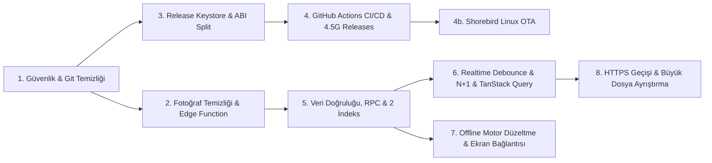

# DOWNTOWN TEKNİK – FAZ 1 UYGULAMA PLANI (EXECUTION PLAYBOOK)

**Bağlı Denetim Raporu:** `docs/FAZ1_TEKNIK_DENETIM.md`  
**Durum:** Onay Bekliyor *(Kullanıcı onayı olmadan uygulama başlatılmaz.)*  
**Prensip:** Mevcut çalışan Web/Mobil/Supabase işlevlerini bozmadan, kademeli, geri alınabilir (reversible) ve her adımı doğrulanmış Faz 1 iyileştirmeleri.

---

## Bağımlılık Akışı (Sıralama Kuralı)

---

## Adım 1 – Acil Güvenlik ve Git Temizliği (P0)

- **Hedef:** Kod içindeki sabit SSH parolasını, Git takibindeki PII eşleme dosyasını ve eksik `.gitignore` kurallarını kapatmak.
- **Etkilenecek Dosyalar:**
  - `scripts/deploy_server.mjs`
  - `.gitignore`
  - `scripts/migration/user_mapping.generated.json` *(yerelde kalır, Git indeksinden çıkarılır)*
  - `scripts/patch_mobile.mjs`
- **Veritabanı Değişikliği:** Yok.
- **Uygulama Adımları:**
  1. Ubuntu sunucusunda SSH key çifti (`ed25519`) yetkilendirilir ve mevcut sunucu parolası değiştirilir.
  2. `scripts/deploy_server.mjs` OpenSSH (`ssh`/`scp`) veya PuTTY `-i` anahtar dosyası kullanacak şekilde güncellenir; sabit parola fallback'i tamamen silinir.
  3. `.gitignore` dosyasına `*.jks`, `*.keystore`, `key.properties`, `*.pem`, `*.p12`, `.env`, `.env.*`, `*.generated.json` eklenir.
  4. `git rm --cached scripts/migration/user_mapping.generated.json` çalıştırılır.
  5. `scripts/patch_mobile.mjs` sabit Supabase anahtarı yerine ortam değişkeninden (`process.env.SUPABASE_ANON_KEY`) okuyacak şekilde güncellenir.
- **Doğrulama:** `git ls-files` içinde `user_mapping.generated.json` olmamalı; `deploy_server.mjs` parola olmadan yalnızca SSH key ile çalışabilmeli.
- **Geri Alma:** `git revert` (yeni sunucu parolası ve SSH key korunur).

---

## Adım 2 – Fotoğraf 15 Günlük Temizlik Mimarisi & Yetki Düzeltmesi (P0)

- **Hedef:** Migration 0016'daki yetkisiz `authenticated` silme açığını kapatmak ve 15 gün sonra `rpc_manager_close_ticket` sırasında `storage.objects` doğrudan SQL `DELETE` nedeniyle iş kapatmanın kilitlenmesini önlemek.
- **Etkilenecek Dosyalar:**
  - `supabase/migrations/20261127000017_photo_retention_edge_safe.sql` *(yeni)*
  - `supabase/functions/purge-expired-photos/index.ts` *(yeni)*
  - `.github/workflows/purge-photos-cron.yml` *(yeni – `pg_cron`/`pg_net` alternatifi veya yedeği)*
- **Veritabanı Değişikliği:** Evet.
  - `rpc_manager_close_ticket` içindeki `perform public.rpc_purge_expired_closed_photos(15);` satırı kaldırılır.
  - `rpc_purge_expired_closed_photos` fonksiyonunun `authenticated` execute yetkisi geri alınır (`revoke execute ... from authenticated`), yalnızca `service_role` yetkisi bırakılır; doğrudan `delete from storage.objects` kaldırılır.
  - `rpc_list_expired_closed_attachments(p_retention_days int default 15, p_batch_limit int default 100)` (`service_role` kısıtlı) ve `rpc_delete_purged_attachment_rows(p_ids uuid[])` (`service_role` kısıtlı) eklenir.
  - `idx_tickets_closed_status_at` kısmi indeksi (`on public.tickets (status, closed_at) where status in ('closed', 'cancelled')`) eklenir.
- **Edge Function Davranışı (`purge-expired-photos`):**
  - Paylaşılan gizli cron başlığı (`X-Cron-Secret`) doğrular.
  - Sadece `work-attachments` bucket'ındaki 15+ günlük `closed`/`cancelled` iş fotoğraflarını 100'lü gruplar halinde çeker.
  - Resmi Supabase Storage API `supabase.storage.from('work-attachments').remove(paths)` ile fiziksel dosyaları siler.
  - **Yalnızca Storage'dan başarıyla silinen** kayıtların `public.attachments` satırlarını siler; `tickets`, `work_orders`, `comments`, `status_history`, `work_order_materials` ve `energy-documents` tamamen korunur.
- **Doğrulama:**
  1. Standart kullanıcı JWT'si ile RPC çağrısı → `permission denied` doğrulaması.
  2. Edge Function `dry_run=true` çağrısı → silinecek aday listesi kontrolü.
  3. Tek bir test kaydıyla gerçek Storage + DB silme doğrulaması.
- **Geri Alma:** Cron tetikleyiciyi durdurma + önceki migration fonksiyonlarına dönüş SQL'i.

---

## Adım 3 – Kalıcı Android Release Keystore, R8 ve ABI-Split (P0/P2)

- **Hedef:** Debug imzadan kalıcı kurumsal release keystore'a geçmek ve 61.27 MB fat APK'yı `arm64-v8a` için ~21.7 MB seviyesine düşürmek.
- **Etkilenecek Dosyalar:**
  - `apps/mobile/android/app/build.gradle.kts`
  - `apps/mobile/android/app/proguard-rules.pro` *(yeni)*
  - `apps/mobile/android/app/src/main/kotlin/com/avmtech/avm_tech_platform/MainActivity.kt` *(cihaz ABI bilgisini `MethodChannel` ile dönmek için)*
  - `apps/mobile/lib/core/update/app_update_service.dart`
  - `apps/web/public/download/version.json`
  - `apps/web/src/app/download/page.tsx`
- **Veritabanı Değişikliği:** Yok.
- **Önemli Operasyon Notu:** Debug keystore → Release keystore geçişinde sahadaki cihazlarda **tek seferlik eski APK'yı kaldırıp yeni APK'yı kurma** gerekir. Bu yüzden ekip bilgilendirilerek tek planlı geçiş yapılmalıdır.
- **Doğrulama:**
  - `flutter build apk --release --split-per-abi` çıktısında `app-arm64-v8a-release.apk` (~21–23 MB) ve `app-armeabi-v7a-release.apk` (~19–21 MB) boyutlarının doğrulanması.
  - `apksigner verify --print-certs` ile SHA-256 parmak izinin kayıt altına alınması.
  - R8 aktifken login, kamera/fotoğraf sıkıştırma, Excel export, bildirim ve güncelleme akışlarının fiziksel cihazda test edilmesi.
- **Geri Alma:** Release yayınından önce `git revert`.

---

## Adım 4 – GitHub Actions CI/CD, 4.5G GitHub Releases & Push Webhook Güvenliği (P1)

- **Hedef:** Windows Device Guard'a takılmadan otomatik test, imzalı APK derleme, GitHub Releases yükleme (4.5G OTA tamamlama) ve Shorebird Linux yama hattı.
- **Etkilenecek Dosyalar:**
  - `.github/workflows/ci.yml` *(yeni)*
  - `.github/workflows/release-mobile.yml` *(yeni)*
  - `supabase/functions/send-push-notification/index.ts` *(gizli webhook doğrulama başlığı)*
  - `apps/mobile/shorebird.yaml` *(Shorebird token GitHub Secrets'a eklendikten sonra)*
- **Veritabanı Değişikliği:** Yok.
- **GitHub Secrets Gereksinimi (Kodda saklanmaz):** `ANDROID_KEYSTORE_BASE64`, `ANDROID_KEY_ALIAS`, `ANDROID_KEY_PASSWORD`, `ANDROID_STORE_PASSWORD`, `SUPABASE_URL`, `SUPABASE_ANON_KEY`, opsiyonel `SHOREBIRD_TOKEN`.
- **Doğrulama:** PR üzerinde `ci.yml` yeşil geçişi; pre-release tag ile GitHub Releases'a yüklenen APK'nın AVM Wi-Fi kapalıyken (4.5G) `AppUpdateService` tarafından indirilip kurulduğunun doğrulanması.
- **Geri Alma:** Workflow dosyalarını pasifleştirme / revert.

---

## Adım 5 – Veri Doğruluğu, Sayfalama, Kısmi İndeksler ve N+1 Düzeltmesi (P1/P2)

- **Hedef:** `.limit(300/500)` kırpılma riskini ortadan kaldırmak, dashboard 6 sorgusunu tek RPC'ye indirmek ve sayaç sıralama N+1 döngüsünü kaldırmak.
- **Etkilenecek Dosyalar:**
  - `supabase/migrations/20261127000018_reporting_pagination_and_indexes.sql` *(yeni)*
  - `apps/web/src/app/(dashboard)/work-tracking/page.tsx`
  - `apps/web/src/app/(dashboard)/work-tracking/work-orders/page.tsx`
  - `apps/web/src/app/(dashboard)/work-tracking/reports/page.tsx`
  - `apps/mobile/lib/features/work_tracking/presentation/screens/ticket_list_screen.dart`
  - `apps/mobile/lib/features/energy/presentation/screens/meter_list_screen.dart`
- **Veritabanı Değişikliği:** Evet.
  - `idx_work_orders_completed_by_at` (`work_orders(completed_by, completed_at DESC) WHERE completed_by IS NOT NULL`). *(Not: `meter_readings(meter_id, reading_date DESC)` zaten mevcut olduğu için eklenmez.)*
  - `rpc_work_tracking_dashboard_summary()` (`SECURITY INVOKER`).
  - `rpc_work_tracking_report_summary(p_start timestamptz, p_end timestamptz)` (`SECURITY INVOKER`).
  - `rpc_reorder_meters(p_meter_ids uuid[])` (enerji düzenleme yetki kontrollü tekil toplu güncelleme).
- **Doğrulama:** Tarih aralığı seçimiyle eski kayıtların doğru döndüğünün, `work-tracking` özetinde 6 yerine 1 istek atıldığının ve `meter_list_screen` sürükle-bırak kaydının tek RPC ile tamamlandığının testi.
- **Geri Alma:** Frontend revert + yeni RPC/indekslerin kaldırılması.

---

## Adım 6 – Realtime Debounce, `select('*')` Daraltma ve Web TanStack Query (P2)

- **Hedef:** Çift/üçlü Realtime yenileme fırtınasını kesmek ve Web ekran geçişlerini anında önbellekli hale getirmek.
- **Etkilenecek Dosyalar:**
  - `apps/web/package.json` (`@tanstack/react-query`)
  - `apps/web/src/app/layout.tsx`, `apps/web/src/app/providers.tsx` *(yeni)*
  - `apps/web/src/core/hooks/useDebouncedRealtime.ts` *(yeni)*
  - `apps/web/src/app/(dashboard)/work-tracking/{page,tickets/page,work-orders/page,review/page}.tsx`
  - `apps/mobile/lib/features/work_tracking/presentation/screens/work_tracking_home_screen.dart`
  - `apps/mobile/lib/features/work_tracking/providers/data_providers.dart`
- **Veritabanı Değişikliği:** Yok.
- **Doğrulama:** Tarayıcı DevTools Network sekmesinde tek aksiyonda tetiklenen istek sayısının doğrulanması; `npm run build` + `npm test`.
- **Geri Alma:** `git revert`.

---

## Adım 7 – Offline Senkronizasyon Motoru Düzeltmeleri ve Ekran Entegrasyonu (P1)

- **Hedef:** Bodrum, otopark ve makine dairesinde internet kesildiğinde arıza kaydı, iş emri tamamlama ve sayaç okuma işlemlerinin veri kaybı olmadan kuyruğa alınıp bağlantı geldiğinde idempotent gönderilmesi.
- **Etkilenecek Dosyalar:**
  - `supabase/migrations/20261127000019_offline_work_order_completed_by.sql` *(yeni – `rpc_sync_offline_work_order_status` içine `completed_by = auth.uid()` ve yorum idempotency)*
  - `apps/mobile/pubspec.yaml` (`connectivity_plus`)
  - `apps/mobile/lib/core/database/offline_sync_engine.dart` (`recoverInterruptedSyncs()` + atomik temp-file yazımı)
  - `apps/mobile/lib/core/database/offline_sync_provider.dart` *(yeni – tekil uygulama-geneli kuyruk yöneticisi)*
  - `apps/mobile/lib/features/work_tracking/presentation/screens/create_ticket_screen.dart`
  - `apps/mobile/lib/features/work_tracking/presentation/screens/technician_work_order_detail_screen.dart`
  - `apps/mobile/lib/features/energy/presentation/screens/reading_entry_sheet.dart`
- **Veritabanı Değişikliği:** Evet (mevcut `rpc_sync_offline_work_order_status` güncellemesi).
- **Doğrulama:** Uçak modunda fotoğraflı arıza oluşturma + iş emri tamamlama + sayaç okuma → internet açıldığında kuyruğun otomatik boşalıp tekil kayıt oluşturduğunu ve `completed_by` alanının dolduğunu doğrulama.
- **Geri Alma:** Kuyruk tetikleyicisini feature flag ile pasifleştirme / `git revert`.

---

## Adım 8 – HTTPS Geçişi ve Monolitik Dosyaların Kademeli Ayrıştırılması (P1/P3)

- **Hedef:** Web tarafında HTTPS ile PWA + QR kamera + güvenli Web API desteği; 1.000+ satırlık en aktif ekranların mevcut işlevselliği koruyarak alt bileşenlere bölünmesi.
- **Etkilenecek Dosyalar:** `apps/web/next.config.mjs`, sunucu Nginx yapılandırması (onay sonrası), `work-tracking/tickets/` ve `work-tracking/work-orders/` alt bileşenleri.
- **Veritabanı Değişikliği:** Yok.
- **Doğrulama:** HTTPS sertifika + PWA yüklenebilirlik + `next build` & manuel regresyon kontrolü.
- **Geri Alma:** Önceki Nginx yapılandırmasına dönüş / `git revert`.
